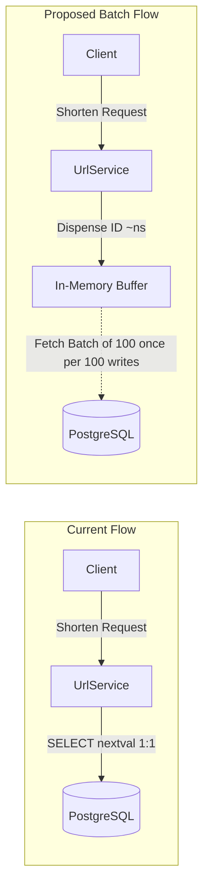
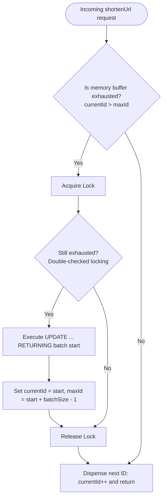

# Implementation Plan: In-Memory Batch ID Allocation (Hi/Lo Range Allocator)

## 1. Problem Statement & Motivation
Currently, for every URL shortening request without a custom alias, CtrlLink performs a direct synchronous database call:
```sql
SELECT nextval('url_id_seq');
```
Under high write loads, calling the database for every single URL generation introduces latency and database connection pool contention.

By allocating counters in batches (e.g., **100 counters per database call**) and caching them in-memory, the backend can dispense IDs locally in nanoseconds. This cuts the database round-trips for ID generation by **99%**.



---

## 2. Architecture & Design

### A. Database Allocation Strategy: Atomic Range Reservation
To support multi-replica deployments (e.g., multiple backend pods/instances) and configurable batch sizes, we need an atomic allocation mechanism in PostgreSQL.

#### Recommended Approach: Dedicated Range Allocator Table
Create a dedicated table `id_range_allocator` managed via Flyway migration:

```sql
CREATE TABLE IF NOT EXISTS id_range_allocator (
    allocator_name VARCHAR(50) PRIMARY KEY,
    next_id BIGINT NOT NULL
);

-- Seed with the current maximum ID or sequence value to prevent overlapping existing IDs
INSERT INTO id_range_allocator (allocator_name, next_id)
SELECT 'url_short_id', COALESCE(MAX(id), 0) + 1 FROM urls
ON CONFLICT (allocator_name) DO NOTHING;
```

**Atomic Allocation Query:**
```sql
UPDATE id_range_allocator
SET next_id = next_id + :batchSize
WHERE allocator_name = 'url_short_id'
RETURNING next_id - :batchSize;
```

**Why this approach?**
1. **Concurrency Safe:** PostgreSQL locks only the single row for `'url_short_id'` during the update. Concurrent backend instances never receive overlapping ID ranges.
2. **Dynamic Batch Sizing:** The batch size is passed as a parameter (`:batchSize`), allowing it to be configured in `application.properties` without database schema changes.
3. **Decoupled from Entity Primary Keys:** Does not interfere with Hibernate's internal sequence generation for `UrlEntity.id`.

---

### B. In-Memory Range Allocator (`IdRangeService`)
A thread-safe Spring service that manages the memory buffer:



#### Thread Safety & Concurrency
- Uses a synchronized block or `ReentrantLock` when refreshing the batch from the database.
- Dispensing from memory is an $O(1)$ integer increment, taking single-digit nanoseconds.
- Double-checked locking prevents multiple concurrent threads from firing duplicate DB requests when a batch empties.

#### Graceful Restarts & Failures
- If the application restarts or crashes, any unassigned IDs remaining in the memory buffer (e.g., 40 out of 100) are simply discarded.
- The next batch fetched from the database resumes cleanly from where the database counter was advanced.
- In distributed URL shorteners, sequence gaps are standard and expected.

---

### C. Integrating with Alias Collision Check
As discussed previously, custom aliases share the Base62 ID namespace. Because dispensing from memory takes negligible CPU time, we can now cleanly prevent collisions with custom aliases:

```java
String shortId;
do {
    Long nextId = idRangeService.getNextId();
    shortId = idEncoder.encode(nextId);
} while (urlRepository.findByShortId(shortId).isPresent());
```
If a counter decodes to an already-claimed custom alias, it instantly discards that single counter and grabs the next one from memory without any extra round-trip to the database sequence.

---

## 3. Step-by-Step Implementation Tasks

### Step 1: Flyway Migration Script
Create `V2__create_id_range_allocator.sql`:
- Create table `id_range_allocator (allocator_name VARCHAR(50) PRIMARY KEY, next_id BIGINT NOT NULL)`.
- Initialize `'url_short_id'` with `COALESCE((SELECT MAX(id) FROM urls), 0) + 1000`.

### Step 2: Spring Configuration Property
In [`application.properties`](file:///Users/sujalagrawal/coding/CtrlLink/CtrlLink%20-%20Backend/src/main/resources/application.properties):
```properties
# URL Shortener ID Generation
app.url.id-batch-size=100
```

### Step 3: Repository / DAO for ID Allocation
Create `IdRangeRepository` (or native query on `UrlRepository`):
```java
@Modifying
@Query(value = """
    UPDATE id_range_allocator
    SET next_id = next_id + :batchSize
    WHERE allocator_name = :allocatorName
    RETURNING next_id - :batchSize
    """, nativeQuery = true)
Long allocateRange(@Param("allocatorName") String allocatorName, @Param("batchSize") int batchSize);
```
*(Note: In Spring Data JPA, `RETURNING` queries in native SQL can be executed via `JdbcTemplate` or custom repository to ensure clean result mapping across PostgreSQL drivers).*

### Step 4: Implement `IdRangeService`
Create `com.sunflower.ctrllink.url.service.IdRangeService`:
- Attributes: `long currentId`, `long maxId`, `int batchSize`, `ReentrantLock lock`.
- Method `public long getNextId()`: thread-safe, fetches batch when `currentId > maxId`.

### Step 5: Update `UrlService`
In [`UrlService.java`](file:///Users/sujalagrawal/coding/CtrlLink/CtrlLink%20-%20Backend/src/main/java/com/sunflower/ctrllink/url/service/UrlService.java):
- Inject `IdRangeService`.
- Replace `Long nextId = urlRepository.getNextId();` with `Long nextId = idRangeService.getNextId();`.
- Wrap in the collision check loop.

### Step 6: Testing & Verification
1. **Unit Test:** Test `IdRangeService` with mock DB allocation (verify it only calls DB once for every 100 calls, and test concurrent multi-thread dispensing).
2. **Integration Test:** Verify URL creation flow with batch allocation and ensure generated URLs remain unique and valid Base62 strings.
3. **Build Verification:** Run `./mvnw clean test` (or compile check) to verify zero regressions.

---

## 4. Key Decisions & Review Checklist
- **Batch Size:** Default 100 (configurable via `app.url.id-batch-size`).
- **Database Strategy:** Table-based atomic `UPDATE ... RETURNING` (flexible, multi-instance safe, independent of JPA sequence generators).
- **Collision Handling:** Integrated with memory-speed retry if shortId matches an existing custom alias.
