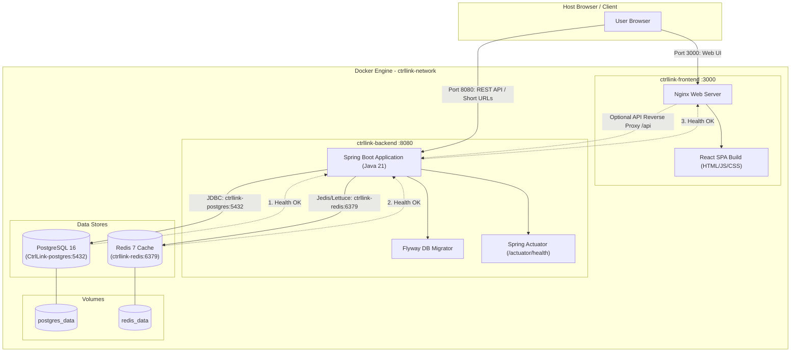

# Implementation Plan: Docker Compose Full-Stack Automation

## 1. Executive Summary & Objectives
Currently, the CtrlLink project relies on a hybrid setup where infrastructure dependencies (PostgreSQL 16 and Redis 7) run via Docker Compose, while the **Backend** (Spring Boot 4 / Java 21) and **Frontend** (React 18 / Vite 5 / TailwindCSS) are executed manually via IDEs or local terminal processes.

The objective of this initiative is to **fully automate the execution and orchestration of the entire CtrlLink stack** using Docker and Docker Compose. With a single command (`docker compose up --build`), developers or CI/CD pipelines will be able to build, link, and run all frontend and backend services alongside their data stores, with zero manual environment configuration required.

---

## 2. Architecture: Current vs. Target State

### Current State
* **PostgreSQL & Redis**: Managed via `docker-compose.yml`.
* **Backend**: Run manually via IDE on `http://localhost:8080`. Hardcoded connection properties (`localhost:5432`, `localhost:6379`) in `application.properties`.
* **Frontend**: Run manually via Vite dev server on `http://localhost:3000`.

### Target State
* **PostgreSQL 16**: Containerized with volume persistence and healthcheck.
* **Redis 7**: Containerized with volume persistence and healthcheck.
* **Backend (Spring Boot 21)**: Multi-stage Docker container built from source, non-root user, configured to dynamically connect to `postgres` and `redis` service hosts, with Spring Actuator health monitoring.
* **Frontend (React + Vite + Nginx)**: Multi-stage Docker container compiling the static distribution and serving it through an optimized Nginx server configured for SPA client routing and port 3000 exposure.
* **Network & Orchestration**: A unified internal Docker bridge network (`ctrllink-network`) connecting all services, with strict health-dependency sequencing (`condition: service_healthy`).
* **Developer Flexibility**: Dual-mode workflow where developers can either run the entire stack in Docker or run services locally in their IDE against containerized databases.



---

## 3. Key Technical Challenges & Solutions

| Challenge | Solution |
| :--- | :--- |
| **Backend DB / Cache Hostnames** | In Docker, services communicate using service names (`postgres`, `redis`). Update `application.properties` with fallback environment variables: `jdbc:postgresql://${POSTGRES_HOST:localhost}:${POSTGRES_PORT:5432}/...`. This ensures zero breakage for developers still using IDEs. |
| **Startup Race Conditions** | Spring Boot will fail to start if PostgreSQL or Redis isn't fully ready. We use Docker Compose `depends_on` with `condition: service_healthy` leveraging existing PostgreSQL `pg_isready` and Redis `ping` checks. |
| **Spring Boot Container Image Size & Security** | Build using multi-stage `maven:3.9.9-eclipse-temurin-21-alpine` for compilation, and `eclipse-temurin:21-jre-alpine` for runtime. Run as a dedicated non-root user (`ctrllink:ctrllink`). |
| **SPA Client-Side Routing in Frontend** | Direct page reloads on routes like `/analytics` or `/urls` return 404 in basic web servers. Configure Nginx with `try_files $uri $uri/ /index.html;` to properly support React Router. |
| **Vite Environment Variables at Build Time** | Vite embeds `VITE_*` variables during `npm run build`. Provide Docker build arguments (`ARG VITE_API_BASE_URL`) with a sensible default (`http://localhost:8080`), allowing customization when needed. |
| **Directory Name with Spaces (`CtrlLink - Backend`)** | Quote paths in Dockerfiles and `docker-compose.yml` (`./CtrlLink - Backend`) to prevent path parsing errors. |

---

## 4. Detailed Component Design & Specifications

### 4.1 Backend Containerization

#### Files:
1. `CtrlLink - Backend/Dockerfile`
2. `CtrlLink - Backend/.dockerignore`
3. `CtrlLink - Backend/src/main/resources/application.properties` (config updates)

#### Multi-Stage Dockerfile Strategy:
* **Stage 1 (Builder):** `maven:3.9.9-eclipse-temurin-21-alpine`
  * Copy `pom.xml` first to cache dependency downloads.
  * Copy `src/` and build the application (`mvn clean package -DskipTests`).
* **Stage 2 (Runtime):** `eclipse-temurin:21-jre-alpine`
  * Install `wget` or `curl` for container health checks.
  * Create non-privileged user and group: `ctrllink:ctrllink`.
  * Copy the compiled `*.jar` from builder.
  * Expose port `8080`.
  * Define Healthcheck: `wget --spider http://localhost:8080/actuator/health || exit 1`.
  * Entrypoint: `java -XX:+UseG1GC -XX:MaxRAMPercentage=75.0 -jar app.jar`.

#### Application Properties Updates:
Decouple hardcoded hosts so they can be injected by Docker while maintaining IDE defaults:
```properties
spring.datasource.url=jdbc:postgresql://${POSTGRES_HOST:localhost}:${POSTGRES_PORT:5432}/${POSTGRES_DB:CtrlLink}
spring.datasource.username=${POSTGRES_USER:admin}
spring.datasource.password=${POSTGRES_PASSWORD:admin}

spring.data.redis.host=${REDIS_HOST:localhost}
spring.data.redis.port=${REDIS_PORT:6379}

app.base-url=${APP_BASE_URL:http://localhost:8080}
app.frontend-url=${APP_FRONTEND_URL:http://localhost:3000}
app.allowed-origin=${APP_ALLOWED_ORIGIN:http://localhost:3000}
```

---

### 4.2 Frontend Containerization

#### Files:
1. `frontend/Dockerfile`
2. `frontend/nginx.conf`
3. `frontend/.dockerignore`

#### Multi-Stage Dockerfile Strategy:
* **Stage 1 (Builder):** `node:20-alpine`
  * Copy `package.json` and `package-lock.json`.
  * Run `npm ci` for fast, reproducible dependency resolution.
  * Accept `ARG VITE_API_BASE_URL=http://localhost:8080`.
  * Copy source code and run `npm run build` to generate `/app/dist`.
* **Stage 2 (Server):** `nginx:1.27-alpine`
  * Copy custom `nginx.conf` to `/etc/nginx/conf.d/default.conf`.
  * Copy built artifacts from Stage 1 to `/usr/share/nginx/html`.
  * Expose port `3000` (consistent with local dev).
  * Run as non-root user or standard alpine nginx process.

#### Nginx Configuration (`frontend/nginx.conf`):
* Listen on port `3000`.
* Root directory `/usr/share/nginx/html`.
* `try_files $uri $uri/ /index.html;` for React Router support.
* Gzip compression for text, javascript, css, and json assets.
* Static asset caching (1 year cache control for `/assets/` hashes).
* Reverse proxy block for `/api/` forwarding to `http://backend:8080` (enabling seamless communication).

---

### 4.3 Root Docker Compose Orchestration

#### File: `docker-compose.yml`
```yaml
services:
  # ── PostgreSQL Database ───────────────────────────────────────────────────
  postgres:
    image: postgres:16-alpine
    container_name: CtrlLink-postgres
    restart: unless-stopped
    environment:
      POSTGRES_DB: ${POSTGRES_DB:-CtrlLink}
      POSTGRES_USER: ${POSTGRES_USER:-admin}
      POSTGRES_PASSWORD: ${POSTGRES_PASSWORD:-admin}
    ports:
      - "5432:5432"
    volumes:
      - postgres_data:/var/lib/postgresql/data
    healthcheck:
      test: ["CMD-SHELL", "pg_isready -U ${POSTGRES_USER:-admin} -d ${POSTGRES_DB:-CtrlLink}"]
      interval: 10s
      timeout: 5s
      retries: 5
    networks:
      - ctrllink-network

  # ── Redis Cache ───────────────────────────────────────────────────────────
  redis:
    image: redis:7-alpine
    container_name: ctrllink-redis
    restart: unless-stopped
    command: redis-server --appendonly yes
    ports:
      - "6379:6379"
    volumes:
      - redis_data:/data
    healthcheck:
      test: ["CMD", "redis-cli", "ping"]
      interval: 10s
      timeout: 5s
      retries: 5
    networks:
      - ctrllink-network

  # ── Backend Application ───────────────────────────────────────────────────
  backend:
    build:
      context: ./"CtrlLink - Backend"
      dockerfile: Dockerfile
    container_name: ctrllink-backend
    restart: unless-stopped
    depends_on:
      postgres:
        condition: service_healthy
      redis:
        condition: service_healthy
    ports:
      - "8080:8080"
    environment:
      POSTGRES_HOST: postgres
      POSTGRES_PORT: 5432
      POSTGRES_DB: ${POSTGRES_DB:-CtrlLink}
      POSTGRES_USER: ${POSTGRES_USER:-admin}
      POSTGRES_PASSWORD: ${POSTGRES_PASSWORD:-admin}
      REDIS_HOST: redis
      REDIS_PORT: 6379
      APP_BASE_URL: ${APP_BASE_URL:-http://localhost:8080}
      APP_FRONTEND_URL: ${APP_FRONTEND_URL:-http://localhost:3000}
      APP_ALLOWED_ORIGIN: ${APP_ALLOWED_ORIGIN:-http://localhost:3000}
      APP_JWT_SECRET: ${APP_JWT_SECRET:-my-super-secret-key-that-is-at-least-256-bits-long-for-hs256}
      APP_ENCRYPTION_SECRET: ${APP_ENCRYPTION_SECRET:-my-ultra-secret-key-32-chars-long}
    healthcheck:
      test: ["CMD", "wget", "--no-verbose", "--spider", "http://localhost:8080/actuator/health"]
      interval: 15s
      timeout: 5s
      retries: 5
      start_period: 30s
    networks:
      - ctrllink-network

  # ── Frontend Application ──────────────────────────────────────────────────
  frontend:
    build:
      context: ./frontend
      dockerfile: Dockerfile
      args:
        VITE_API_BASE_URL: ${VITE_API_BASE_URL:-http://localhost:8080}
    container_name: ctrllink-frontend
    restart: unless-stopped
    depends_on:
      backend:
        condition: service_healthy
    ports:
      - "3000:3000"
    networks:
      - ctrllink-network

networks:
  ctrllink-network:
    driver: bridge

volumes:
  postgres_data:
  redis_data:
```

---

## 5. Step-by-Step Implementation Steps

### Phase 1: Environment & Backend Containerization
1. Create `.dockerignore` in `CtrlLink - Backend/` to exclude `target/`, `.idea/`, `.git/`, and log files.
2. Update `CtrlLink - Backend/src/main/resources/application.properties` to use parameterized environment variables with fallback defaults (`${POSTGRES_HOST:localhost}`).
3. Author `CtrlLink - Backend/Dockerfile` utilizing multi-stage build (Maven compile + JRE runtime).
4. Verify backend image build locally via Docker CLI.

### Phase 2: Frontend Containerization & Web Server Setup
1. Create `.dockerignore` in `frontend/` to exclude `node_modules/`, `dist/`, `.git/`, and cache directories.
2. Create `frontend/nginx.conf` configured for port 3000, SPA routing (`try_files`), asset caching, and reverse-proxying.
3. Author `frontend/Dockerfile` utilizing multi-stage build (Node build + Nginx runtime).
4. Verify frontend image build locally via Docker CLI.

### Phase 3: Compose Orchestration & Integration
1. Update root `docker-compose.yml` to define all 4 services with health checks, dependencies, environment variable mapping, and custom network.
2. Provide a `.env.example` file in the project root documenting available override variables (database credentials, JWT secret, ports).
3. Add root convenience documentation in `README.md` for running with Docker (`docker compose up -d --build`).

### Phase 4: Validation & Quality Assurance
1. **Clean Orchestration Test**: Stop running standalone containers (`docker compose down`) and execute `docker compose up --build -d`.
2. **Health Verification**: Ensure all 4 containers reach `healthy` / `running` status in `docker compose ps`.
3. **Database Migration Check**: Verify Flyway migrations run successfully against PostgreSQL inside the container network.
4. **API Sanity Test**: Query `http://localhost:8080/actuator/health` to verify database and redis connections report `UP`.
5. **Frontend Web UI Sanity Test**: Load `http://localhost:3000` in the browser, ensure authentication, dashboard, URL shortening, and analytics modal function correctly.
6. **Data Persistence Test**: Stop containers (`docker compose down`), start again (`docker compose up -d`), and verify created URLs and statistics persist.
7. **IDE Backward Compatibility Test**: Verify that running the backend or frontend outside Docker (with just `docker compose up postgres redis`) continues to function as before without config regressions.

---

## 6. Review & Approval Decision Points
Please review the proposed plan:
* **Frontend Serving Strategy**: Are you happy with using Nginx (serving production build on port 3000), or would you prefer a development-mode container (running Vite live reload with volume mounted source code)? *(Nginx is standard for `docker compose up`, but dev mode can be added as a separate compose profile/override if desired).*
* **Port Mappings**: Ports remain `3000` (Frontend), `8080` (Backend), `5432` (PostgreSQL), and `6379` (Redis).
* **Branch & PR Strategy**: A dedicated branch `feature/docker-compose-automation` is created, and this plan is committed and submitted as a GitHub Pull Request for formal tracking.
